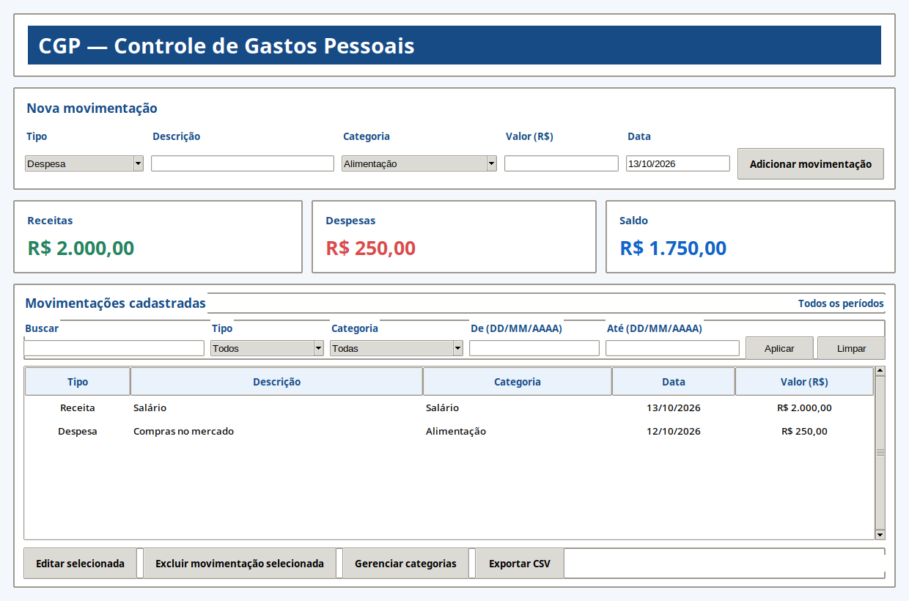
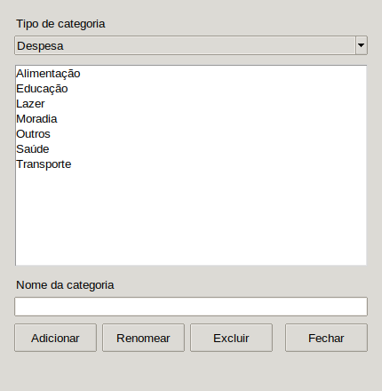

# CGP — Controle de Gastos Pessoais

Aplicativo desktop para Linux e Windows que organiza receitas e despesas em um banco SQLite local.

## Funcionalidades

- Cadastro, edição e exclusão de receitas e despesas.
- Categorias separadas por tipo de movimentação.
- Busca e filtros por período, tipo e categoria.
- Resumo de receitas, despesas e saldo conforme os filtros ativos.
- Exportação das movimentações filtradas para CSV.
- Persistência local entre execuções.

## Requisitos

- **Linux:** distribuição Debian ou Ubuntu compatível, Python 3.11 ou superior e Tkinter. O pacote `.deb` requer `python3` 3.11 ou superior e `python3-tk`.
- **Windows:** Windows 64 bits para o executável distribuído. A execução a partir do código-fonte requer Python 3.11 ou superior com Tcl/Tk.
- SQLite, incluído na biblioteca padrão do Python.

Para preparar o ambiente Linux para executar o código-fonte, instale Python, suporte a ambientes virtuais e Tkinter:

```sh
sudo apt install python3 python3-venv python3-tk
```

## Instalação e execução

### Executáveis da release

Baixe o pacote correspondente ao seu sistema na [release CGP v1.0.0](https://github.com/beatrizcrmg/projeto-integrador-cgp/releases/tag/v1.0.0).

No Linux, instale o pacote Debian:

```sh
sudo apt install ./cgp_1.0.0_all.deb
```

Depois, inicie o aplicativo pelo menu do sistema ou execute `cgp` em um terminal.

No Windows 64 bits, baixe e execute `CGP-1.0.0-windows-x64.exe`. O executável inclui o ambiente necessário para iniciar o aplicativo.

### Execução a partir do código-fonte

No Linux, com os requisitos instalados, execute na raiz do projeto:

```sh
make setup
make run
```

No Windows, use o PowerShell:

```powershell
py -3.11 -m venv .venv
$env:PYTHONPATH = "src"
.\.venv\Scripts\python.exe -m cgp
```

## Especificações técnicas

- **Interface:** Python com Tkinter e ttk.
- **Arquitetura:** camadas separadas para interface (`ui`), regras de domínio (`domain`), operações financeiras e exportação (`services`) e acesso a dados (`storage`).
- **Persistência:** SQLite local, inicializado automaticamente. Valores monetários são armazenados como centavos inteiros.
- **Exportação:** CSV com os dados das movimentações filtradas.
- **Dependências de execução:** somente a biblioteca padrão do Python, incluindo Tkinter, `sqlite3` e `csv`.
- **Dados locais no Linux:** `$XDG_DATA_HOME/cgp/cgp.sqlite3` quando `XDG_DATA_HOME` estiver definido; caso contrário, `~/.local/share/cgp/cgp.sqlite3`.
- **Dados locais no Windows:** `%APPDATA%\CGP\cgp.sqlite3`; se `APPDATA` não estiver definido, o aplicativo usa `AppData\Roaming\CGP\cgp.sqlite3` dentro da pasta do usuário.
- **Pacote Linux:** `.deb` para arquitetura independente, com launcher `cgp`; requer Python 3.11 ou superior e Tkinter do sistema.
- **Pacote Windows:** executável standalone para Windows 64 bits, compilado com PyInstaller e sem janela de terminal.

## Capturas de tela

As imagens mostram somente as janelas do aplicativo, sem a janela de terminal.





## Testes

No Linux, execute a suíte de testes com:

```sh
make test
```

No Windows, com o ambiente virtual criado conforme as instruções acima, execute no PowerShell:

```powershell
$env:PYTHONPATH = "src"
.\.venv\Scripts\python.exe -m unittest discover -s tests -v
```
